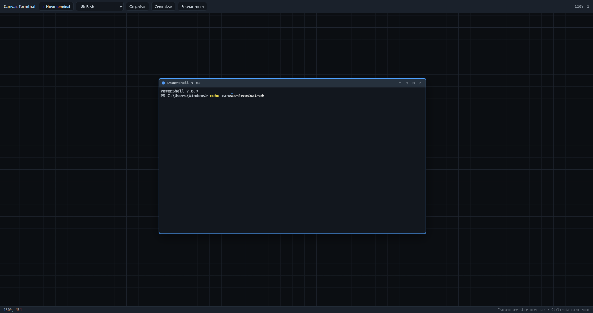
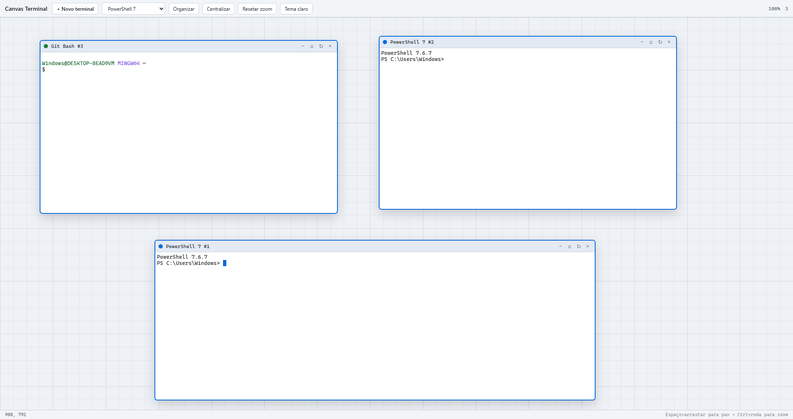

# Canvas Terminal

Aplicativo desktop de **canvas infinito** com terminais reais (PowerShell, cmd, Git Bash, WSL no Windows; bash, zsh, fish, pwsh, sh no Linux), construído com **Tauri 2**, **Vite**, **TypeScript** e **xterm.js**.

O mesmo código-fonte compila tanto no **Windows** quanto no **Linux** (e macOS, com os devidos cuidados de empacotamento).

Tema escuro (padrão):



Tema claro:



---

## Requisitos

### Windows

- Windows 10 19045 ou superior
- WebView2 Runtime instalado
- Node.js 22+
- Rust stable (toolchain `msvc`)
- MSVC 2019 BuildTools

### Linux (Ubuntu/Debian)

- Node.js 22+
- Rust stable
- Dependências de sistema do Tauri/GTK/WebKit:

```bash
sudo apt install libwebkit2gtk-4.1-dev build-essential curl wget file libssl-dev \
  libgtk-3-dev libayatana-appindicator3-dev librsvg2-dev libxdo-dev
```

---

## Instalação

```bash
npm install
cd src-tauri
cargo add portable-pty base64
```

---

## Desenvolvimento

```bash
npm run tauri dev
```

A janela será aberta com a toolbar, canvas infinito e um terminal inicial no centro.

---

## Build / empacotamento

### Windows

```bash
npm run build
cd src-tauri && cargo build
```

Para gerar o instalador (NSIS/MSI):

```bash
npm run tauri build
```

Os instaladores ficarão em `src-tauri/target/release/bundle/` (subpastas `nsis/` e `msi/`).

### Linux

```bash
npm run build
cd src-tauri && cargo build
```

Para gerar os pacotes (`.deb`, `.rpm`, `.AppImage`):

```bash
npm run tauri build
```

Os pacotes ficarão em `src-tauri/target/release/bundle/` (subpastas `deb/`, `rpm/` e `appimage/`).

---

## Interface

O cabeçalho é uma barra de menus com as categorias **Arquivo**, **Exibir**,
**Janela** e **Ajuda**. Ele fica escondido para deixar mais espaço ao canvas e
desce automaticamente quando o mouse encosta no topo da tela (ou quando algum
item recebe foco pelo teclado).

Use **Exibir → Tela cheia** (`F11`) para esconder a moldura da janela, a barra
de tarefas do sistema e a barra de status. O cabeçalho também fica oculto, mas
continua disponível: encoste o mouse no topo da tela para ele descer. Para sair
da tela cheia use **F11**/`Ctrl+Shift+F`, o botão **⛶** no cabeçalho ou o item
**Exibir → Sair da tela cheia**; `Esc` não sai do fullscreen.

O zoom é uniforme: janelas, barra de título, controles e o texto dos terminais
escalam juntos, sem reflow do conteúdo. Vá de 25% a 300% com `Ctrl + roda do
mouse`, `Ctrl+=` / `Ctrl+-` ou pelo menu **Exibir**.

Para navegar sem o mouse, clique em uma área vazia do canvas e use **WASD** ou
as **setas** (segure para pan contínuo). Clicar em um terminal devolve o foco ao
shell.

---

## Áreas de trabalho (abas)

As abas no cabeçalho funcionam como **áreas de trabalho independentes**: cada
uma tem seus próprios terminais, posição e zoom. As sessões continuam vivas ao
trocar de aba.

- **+** cria uma nova área com um terminal no centro.
- Clique em uma aba para trocar de área; clique em **×** para fechar (com
  confirmação se houver terminais).
- **Duplo clique no nome da aba** renomeia a área.
- `Ctrl+Shift+T` cria uma área; `Ctrl+Tab` e `Ctrl+Shift+Tab` alternam.
- O menu **Janela** também traz essas ações.

Quando um terminal está **maximizado**, o cabeçalho dele vira uma barra de abas
com os nomes de todos os terminais daquela área. Clique em um nome para trazer
outro terminal para a visão maximizada. Fora do modo maximizado, a visão normal
do canvas é mantida.

---

## Comandos rápidos

O painel translúcido no canto inferior esquerdo guarda seus comandos favoritos.
Ele fica **oculto** e aparece quando o mouse encosta no canto inferior esquerdo
da tela. Clique em **+**, dê um nome (opcional) e informe o comando. Marque
**Executar depois de colar** se quiser que o `Enter` seja enviado
automaticamente; sem a marca, o comando é apenas colado no terminal em foco para
você confirmar.

- O painel pode ser recolhido pelo botão `▾` (o estado é lembrado).
- Comandos marcados para executar exibem um `↵` na lista.
- Clique no lápis **✎** para editar: o formulário abre preenchido e o botão
  passa a ser **Atualizar**.
- Para remover um comando, clique em `×`.
- Os comandos ficam salvos em `localStorage["canvas-terminal.quick-commands.v1"]`.
- Em tela cheia o painel continua disponível no mesmo canto.

---

## Atalhos

| Atalho | Ação |
|--------|------|
| `Ctrl+T` (ou `Cmd+T`) | Novo terminal no centro do viewport |
| `Ctrl+Shift+T` | Nova área de trabalho |
| `Ctrl+Tab` / `Ctrl+Shift+Tab` | Próxima / área de trabalho anterior |
| `Ctrl+Q` (ou `Cmd+Q`) | Sair do aplicativo |
| `Ctrl+Shift+W` (ou `Cmd+Shift+W`) | Fechar terminal em foco (funciona com o terminal focado) |
| `Ctrl+W` com o terminal em foco | Vai para o shell (apaga a palavra anterior); fora dele, fecha o terminal |
| `Ctrl+PageDown` / `Ctrl+PageUp` | Ciclar foco entre terminais |
| `Ctrl+0` (ou `Cmd+0`) | Resetar zoom (100%, ancorado no centro) |
| `Ctrl+=` / `Ctrl+-` | Aumentar / diminuir o zoom |
| `F11` / `Ctrl+Shift+F` | Alternar tela cheia (só sai por aqui ou pelo menu) |
| `Esc` | Fechar menu ou diálogo |
| `Ctrl+Shift+L` (ou `Cmd+Shift+L`) | Alternar tema claro/escuro |
| `Ctrl+Shift+V` / `Ctrl+V` (ou `Cmd+Shift+V` / `Cmd+V`) | Colar no terminal |
| `Ctrl+C` (ou `Cmd+C`) com seleção | Copiar do terminal |
| `F2` | Renomear título do terminal |
| `Espaço + arrastar` | Pan do canvas |
| `Botão do meio` / `botão direito` | Pan do canvas |
| `WASD` / setas | Navegar no canvas (clique antes em uma área vazia) |
| `Ctrl + roda do mouse` | Zoom no cursor |
| `Shift + roda do mouse` | Pan horizontal |

---

## Tema (claro / escuro)

O app tem dois temas completos. Escolha em **Exibir → Tema claro/escuro** ou
com `Ctrl+Shift+L` — a troca é imediata, inclusive no conteúdo dos terminais
(a paleta do xterm.js é reaplicada nos terminais já abertos).

Sem escolha explícita, o app **segue o tema do sistema operacional**
(`prefers-color-scheme`); a escolha manual é lembrada em:

```
localStorage["canvas-terminal.theme.v1"]
```

As cores ficam em variáveis CSS em `src/styles.css` (`:root` = escuro,
`:root[data-theme="light"]` = claro); as paletas do terminal estão em
`src/theme.ts`. A moldura da janela segue o sistema (`theme: null` no
`tauri.conf.json`).

---

## Preferências

O layout de todas as áreas de trabalho (abas, terminais, posição e zoom) é
salvo automaticamente em:

```
localStorage["canvas-terminal.workspaces.v1"]
```

O layout antigo de área única (`canvas-terminal.layout.v1`) é migrado
automaticamente para a primeira área na primeira execução desta versão.

---

## Shell padrão

O app detecta automaticamente os shells disponíveis no sistema operacional:

### Windows

1. PowerShell 7 (`pwsh.exe`)
2. Windows PowerShell (`powershell.exe`)
3. Prompt de Comando (`cmd.exe`)
4. Git Bash (`bash.exe`)
5. WSL (`wsl.exe`)

### Linux

1. `bash`
2. `zsh`
3. `fish`
4. `pwsh` (PowerShell 7)
5. `sh`

O shell padrão escolhido é `$SHELL` (se válido) → `bash` → `zsh` → `sh`.

Para forçar um shell específico em qualquer plataforma, defina a variável de ambiente:

```bash
export CANVAS_TERMINAL_SHELL="/caminho/para/meu-shell"
```

No Windows (PowerShell):

```powershell
$env:CANVAS_TERMINAL_SHELL = "C:\caminho\para\meu-shell.exe"
```

---

## Lentidão no terminal (Windows): hospedeiros ConPTY órfãos

Cada terminal é um **ConPTY**, e todo ConPTY tem um processo hospedeiro
(`conhost.exe`). Se o processo do app morrer de forma abrupta — Gerenciador de
Tarefas, `taskkill /F`, um crash — em um momento em que o terminal está
produzindo saída, o `conhost.exe` pode sobreviver **sem cliente** e entrar em
laço de CPU, queimando um núcleo inteiro para sempre. Alguns desses acumulados
saturam a máquina, e o sintoma é exatamente "o terminal ficou lento, as letras
demoram a aparecer" — inclusive em outros programas.

Medição real desta máquina (mesma sonda, mesmo código, antes e depois de
encerrar 11 conhosts órfãos que somavam ~160.000 s de CPU):

| cenário | comando inteiro | tecla | rajada de 50 linhas |
| --- | --- | --- | --- |
| CPU saturada (100%) | 3.858 ms | 2.425 ms | sem resposta |
| CPU livre (16%) | **19,9 ms** | **3,3 ms** | **292 ms** |

Fechar a janela normalmente **não** deixa resíduo: o app encerra todos os PTYs
em `RunEvent::ExitRequested` / `WindowEvent::Destroyed`. Prefira sempre fechar
pela janela (ou `taskkill /IM`, sem `/F`) em vez de "Finalizar tarefa".

Se a máquina ficar lenta, a ferramenta `tools/limpar-conhosts-orfaos.ps1`
encerra apenas hospedeiros órfãos **e girando** (filtros: processo-pai morto,
sem janela visível, consumo de CPU sustentado — consoles clássicos que você
esteja usando são ignorados):

```powershell
# só lista o que seria encerrado
pwsh -NoProfile -ExecutionPolicy Bypass -File tools/limpar-conhosts-orfaos.ps1 -Simular

# encerra
pwsh -NoProfile -ExecutionPolicy Bypass -File tools/limpar-conhosts-orfaos.ps1
```

---

## Estrutura

- `src/main.ts` — bootstrap da UI
- `src/canvas.ts` — viewport infinito (pan/zoom/grid)
- `src/terminal-window.ts` — janela de terminal com xterm.js
- `src/pty.ts` — wrapper do backend Tauri
- `src/persistence.ts` — salvamento de layout
- `src/styles.css` — tema escuro
- `src-tauri/src/shells.rs` — descoberta de shells por plataforma (`#[cfg(windows)]` / `#[cfg(unix)]`)
- `src-tauri/src/pty.rs` — backend PTY com `portable-pty`
- `src-tauri/tests/pty_test.rs` — teste de integração headless
- `tools/limpar-conhosts-orfaos.ps1` — limpeza de hospedeiros ConPTY órfãos (Windows)

---

## Testes

```bash
cd src-tauri && cargo test    # teste de integração do PTY (Windows e Linux)
npx tsc --noEmit              # checagem de tipos do frontend
```

A integração contínua (`.github/workflows/ci.yml`) roda os dois em `ubuntu-22.04`
e `windows-latest` a cada push.

---

## Licença

MIT — veja [LICENSE](LICENSE).

Copyright (c) 2026 Wilian Stancke.

